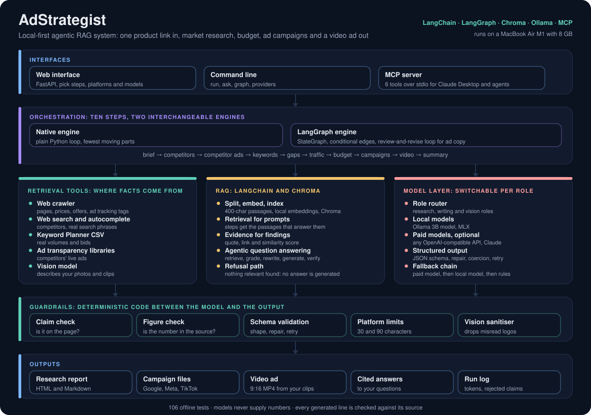
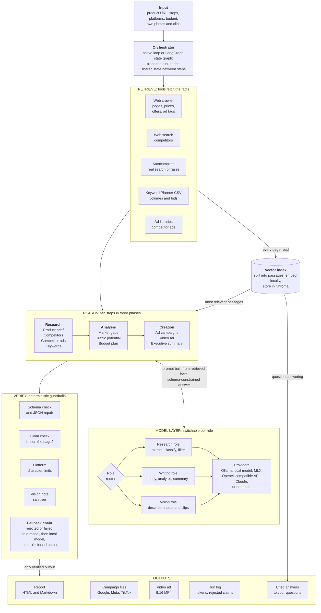
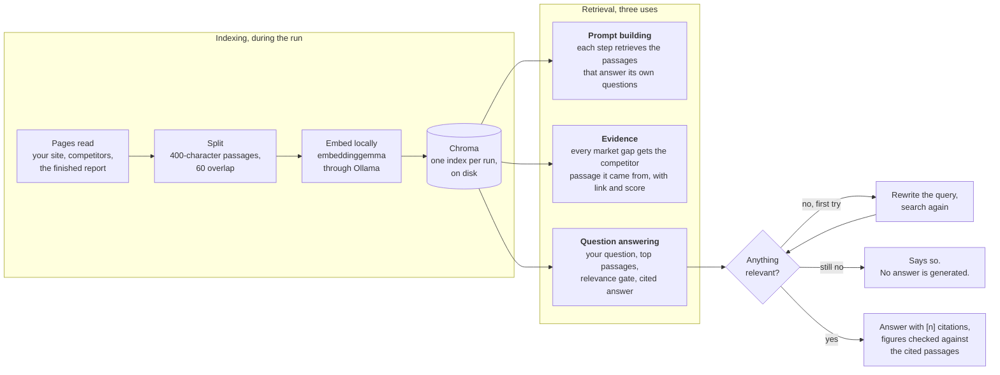
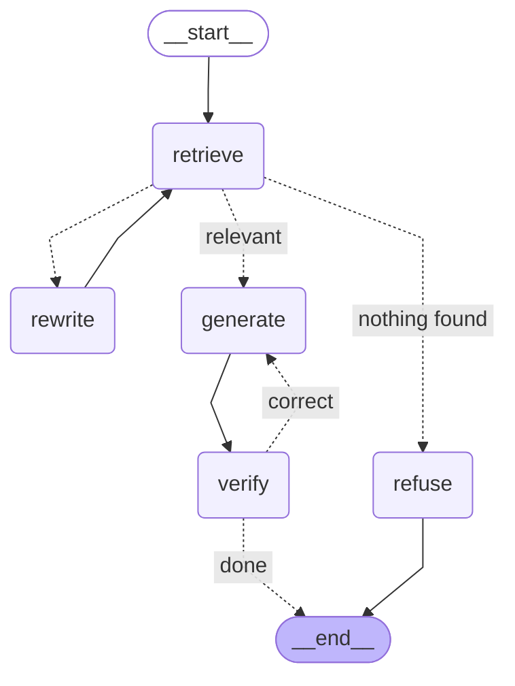
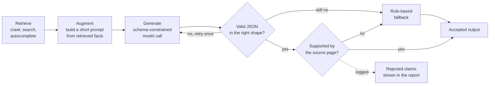
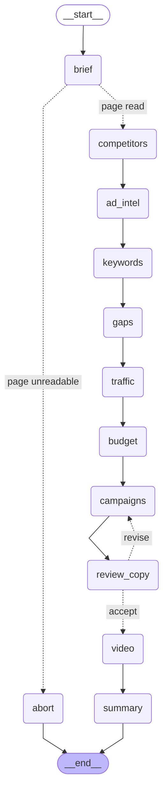
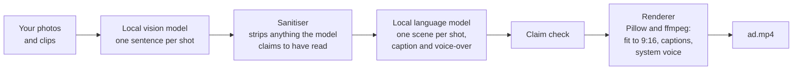
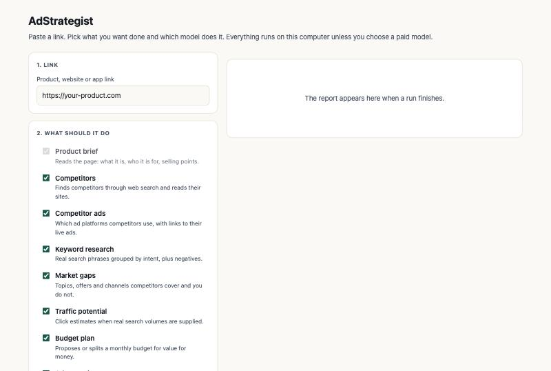

# AdStrategist

**A local-first agentic RAG system that turns one product link into market research, a budget plan, ready-to-review ad campaigns and a video ad.**

`Python` · `LangChain` · `LangGraph` · `Chroma` · `Ollama` · `MCP` · `FastAPI` · 106 offline tests

Paste a URL. An agentic pipeline of retrieval tools and language models reads the product page, finds competitors, researches keywords, analyses market gaps, plans a budget, writes campaigns for Google, Meta and TikTok, and edits a vertical video ad from your own photos and clips. Every page it reads goes into a local vector index, so its prompts are built by retrieval (RAG) and you can ask questions about the finished research and get answers with cited sources.

It runs on a MacBook Air M1 with 8 GB of RAM using a 3B-parameter local model, and can hand the quality-sensitive writing to a paid model when you choose to.



## Why this project is interesting

Small local models hallucinate, lose track of long tasks and cannot plan reliably. Most of the engineering here is about getting dependable output from them anyway:

- The model never plans the run and never supplies a number. Code orchestrates, tools retrieve, models read and write.
- Every generated line is checked against the source page before it can reach a campaign.
- Every model call has a schema, a validator, a retry and a rule-based fallback, so a run never fails because a model misbehaved.
- Any role can be switched between a local model, a paid API, or no model at all.
- Pages are chunked, embedded locally and stored in a Chroma vector index (LangChain). Prompts get the most relevant passages, findings get evidence quotes, and a question-answering chain refuses to answer when retrieval finds nothing.
- The pipeline runs on two interchangeable engines: a plain Python loop and a LangGraph state graph that adds a review-and-revise cycle for ad copy.
- Question answering is agentic RAG: a second LangGraph that grades what it retrieved, rewrites the query and searches again when it found nothing, and sends a draft back when its figures are not in the cited passages.
- An MCP server exposes the whole thing as tools, so Claude Desktop or any other MCP client can start research runs and query the results.

## System flow



## Retrieval-augmented generation

Built with LangChain components: `RecursiveCharacterTextSplitter`, `OllamaEmbeddings`, a `Chroma` vector store, and an agentic question-answering graph in LangGraph with an LCEL generation chain inside it. Embeddings always run locally, so page text is never sent to a paid service just to be indexed.



What retrieval changes in practice:

- **Prompt building.** Without retrieval a small model sees the first 2,200 characters of the homepage. With it, up to six pages of the site are indexed and the prompt gets the passages that are actually about the product, its prices and its benefits.
- **Evidence.** A finding like "competitors lead with gift boxes" comes with the passage it was drawn from, the link, and a similarity score. It also checks your own pages for a passage about the same thing in other words.
- **Question answering.** `adstrategist ask "which competitors offer a guarantee?"` answers from the index with numbered citations. If no passage clears the relevance threshold, even after one rewritten search, no answer is generated, so the model cannot invent one.

Ask from the command line:

```bash
.venv/bin/adstrategist ask "Which competitors offer free shipping?"
```

### Agentic RAG: the question-answering graph

A plain RAG chain retrieves once and answers whatever it gets. This one decides its next move from what it finds. Generated from the code by `adstrategist graph ask`:



- **retrieve, then grade:** passages below the relevance threshold are discarded. With none left, the graph does not answer.
- **rewrite:** on a first miss, the local model restates the question as a search query in the language and vocabulary of the indexed pages, and the search runs once more.
- **verify, then correct:** every figure in the draft must appear in a passage it cites. If not, the draft goes back to the model once with the offending figures named. A figure that survives that is flagged to the reader.

## The grounded generation loop

Around every model call, whichever engine runs it:



## The LangGraph engine

The same pipeline as a LangGraph `StateGraph`. Every step is a node, and the graph adds two things a plain loop does not have: a conditional edge that routes an unreadable page to `abort`, and an evaluator-optimizer cycle where a deterministic reviewer (the claim check) sends rejected ad copy back to the writing model with notes, once.

This diagram is generated from the code by `adstrategist graph`:



Both engines call the same step functions, and a test asserts they produce identical research. Choose with `--engine langgraph`, `ENGINE=langgraph` in `.env`, or the engine menu in the web form.

## MCP server

`adstrategist mcp` runs a Model Context Protocol server over stdio, so an MCP client can drive the system as tools:

| Tool | What it does |
|---|---|
| `start_research` | Starts a run for a product link and returns a run id at once (runs take minutes) |
| `research_status` | Progress and errors of a run |
| `list_runs` | Finished runs |
| `get_report` | The report of a run, whole or one section |
| `get_campaigns` | The generated campaigns as structured data |
| `ask_research` | A question answered by the agentic RAG graph, with cited sources |

There is also a resource template, `adstrategist://runs/{run_id}/report`. Problems the caller can fix (a bad link, an unknown run, a run without an index) come back as readable tool errors.

Claude Desktop configuration:

```json
{
  "mcpServers": {
    "adstrategist": {
      "command": "/absolute/path/to/ad-strategist/.venv/bin/adstrategist",
      "args": ["mcp"]
    }
  }
}
```

## The video sub-pipeline

A multimodal chain: a vision model looks, a language model writes, deterministic code renders.



## AI concepts used, and where to find them

| Concept | How it is used here | Code |
|---|---|---|
| **Agentic workflow** | A multi-step pipeline where language models work from tool results and pass state between steps. Planning is done by code (a step registry with dependency resolution), not by the model, because a 3B model cannot plan a ten-step task reliably. | `pipeline.py`, `steps/__init__.py`, `context.py` |
| **Tool use** | Crawler, web search, autocomplete, CSV import, ad libraries, ffmpeg and a system voice are the tools. Their results are the only source of facts. | `web_fetch.py`, `sources/` |
| **Retrieval-augmented generation** | Crawled pages are split into passages, embedded locally and stored in a Chroma vector index. Steps retrieve the passages that answer their questions instead of trimming page text, findings carry retrieved evidence, and the output is verified against the source. | `rag.py`, `steps/brief.py`, `steps/competitors.py`, `steps/gaps.py` |
| **Vector search and embeddings** | Local multilingual embedding model through Ollama, with the query and document prefixes the model was trained on. Cosine similarity, metadata filters (one site, everything but your own site, report only). | `rag.py` |
| **Agentic RAG (LangGraph + LCEL)** | A graph that retrieves, grades relevance, rewrites the query and retries on a miss, generates with an LCEL chain (prompt, model, parser), verifies figures against cited passages and sends the draft back once if they fail. Refuses when nothing relevant is found. | `ask.py` |
| **Model Context Protocol (MCP)** | An MCP server with six tools and a resource template, so Claude Desktop and other agents can run research and query results. Long runs are started in the background and polled, because tool calls should return quickly. | `mcp_server.py` |
| **Stateful agent graph (LangGraph)** | The pipeline as a `StateGraph` with typed state and reducers, conditional edges, and a cycle. | `graph.py` |
| **Evaluator-optimizer loop** | A deterministic reviewer checks each ad copy draft. Rejected lines go back to the writing model with the reasons, for one revision. | `graph.py`, `steps/campaigns.py` (`review_copy`) |
| **Grounding and hallucination control** | A claim check rejects any generated line containing a number, discount, free offer, guarantee, superlative or health claim that the source page does not contain. Rejected lines are logged and replaced. | `claims.py` |
| **Faithfulness checks on figures** | Every figure in a model-written summary must be one the model was given, and every figure in an answer must appear in a passage it cites. A miss gets one corrected attempt, then a rule-based fallback or a visible warning. Number formats are normalised first (1.727, 1,727 and 1727 are the same figure). | `claims.py` (`missing_numbers`), `steps/summary.py`, `ask.py` |
| **Structured output** | Every model call that feeds code has a JSON schema. It is enforced with constrained decoding where the provider supports it, then parsed, repaired, coerced into shape and retried once. | `llm/base.py`, `llm/__init__.py` |
| **Model routing** | Two roles are routed separately. Research (many small extraction calls) stays local. Writing (few calls where quality matters) can go to a paid model. | `llm/__init__.py` |
| **Provider abstraction** | One interface, five backends: Ollama, MLX, any OpenAI-compatible API, Claude, and a no-model mode. Switching is a setting, not a code change. | `llm/providers.py` |
| **Fallback chains** | Paid model fails: fall back to the local model. Local model fails: fall back to deterministic rules. The run always completes. | `llm/__init__.py`, every `steps/*.py` |
| **Multimodal chaining** | A local vision model describes each photo or video frame. A text model writes the script from those notes. | `sources/vision.py`, `media.py`, `steps/video.py` |
| **LLM as classifier** | The model filters search results down to real competitors and removes off-target keywords. Its verdict is ignored if it rejects more than 60% of the list. | `steps/competitors.py`, `steps/keywords.py` |
| **Prompting small models** | Short single-purpose prompts, a fill-in-the-blanks example of the output, and example lists sized to the wanted length (small models copy the example's length). | `llm/base.py` (`skeleton`) |
| **Separation of reasoning and arithmetic** | Budgets, click and conversion ranges are computed in code from labelled benchmarks and real bids. The model only explains them. | `steps/budget.py`, `steps/traffic.py` |
| **Local inference** | Quantised 3B model through Ollama on 8 GB of memory. With local models only, no page content leaves the machine. | `llm/providers.py` |
| **Observability** | Each run records model calls, tokens, timings per step, every warning and every rejected claim. | `pipeline.py`, `report.py` |
| **Testing AI systems** | 106 offline tests. A fake web, scripted fake models and a deterministic stand-in embedder make model behaviour repeatable, including bad JSON, invented discounts, refused API calls, engine parity and the revise loop. | `tests/` |

## Where LangChain and LangGraph are used, and where they are not

| Part | Built with | Why |
|---|---|---|
| Chunking, embeddings, vector store, retrieval | LangChain (`langchain-text-splitters`, `langchain-ollama`, `langchain-chroma`) | Standard, well-tested components. No reason to rewrite them. |
| Question answering | LangGraph for the control flow (grade, rewrite, verify loops), LangChain LCEL for the generation chain | Loops and branching belong in a graph; prompt, model and parser compose cleanly as a chain. |
| Tool server for other agents | MCP Python SDK | The standard way to expose tools to Claude Desktop and other MCP clients. |
| Pipeline engine with a review loop | LangGraph `StateGraph` | Cycles and conditional routing are what a graph is for. |
| Model providers, role routing, fallbacks | Custom (`llm/`) | Needs tight control of prompt size, schema scaffolding for 3B models and a three-level fallback, and keeps the core install to five packages. |
| The ten step functions | Plain Python, shared by both engines | So the native loop and the graph can be compared like for like. |

The LangChain stack and the MCP server are optional installs (`pip install -e ".[rag,mcp]"`). Without it, or without the embedding model, the tool still runs: steps fall back to trimmed page text and the native engine.

## Design decisions

1. **Models never produce numbers.** Search volumes, bids and budgets come from data sources or are benchmark assumptions labelled as such. A small model will invent them otherwise.
2. **Copy may only say what the page supports.** In testing, a 3B model wrote "20% off" for a shop with no such offer. The claim check removed it.
3. **Code plans, models execute.** A deterministic pipeline with model calls inside each step is more reliable on small models than a free-roaming agent loop.
4. **Vision output is treated as untrusted.** A vision model misread a logo as a brand name and the script then advertised that brand. Anything the vision model claims to have read is now stripped and blocked.
5. **Degrade, do not fail.** No model, no network result, no vector index or a refused API call each reduce quality but never stop the run.
6. **Retrieval needs a refusal path.** The embedding model was chosen partly because off-topic questions score far below relevant ones (about 0.06 against 0.36 or more in testing), which makes a "not in the research" threshold possible. A model that scores everything around 0.6 cannot be gated.
7. **Generated text becomes a source, so check it first.** The finished report is indexed for question answering. In testing, a 3B model wrote "60% Google, 40% Meta" in the summary when the plan said 55% and 45%, and the answer chain then quoted that summary faithfully. Summary figures are now verified against the data before the report is indexed.
8. **Embed locally, even when writing is paid.** Indexing touches every page in full. Keeping it on the machine means only the few retrieved passages ever reach a paid model.

## What it produces

| Step | Output | Data source |
|---|---|---|
| Product brief | Category, audience, selling points, offers, tracking tags | The page itself |
| Competitors | Up to 5 competitors with positioning, prices, offers | Autocomplete ("brand vs"), web search, their homepages |
| Competitor ads | Ad platforms each competitor is set up on, links to their live ads | Tracking tags, public ad libraries |
| Keyword research | Phrases grouped by intent, negative keywords | Google autocomplete, optional Keyword Planner CSV |
| Market gaps | Topics, offers and channels competitors cover and you do not | Comparison of the retrieved pages |
| Traffic potential | Click and cost ranges | Keyword Planner CSV only |
| Budget plan | Proposed or split budget, click and conversion ranges, payback check | Arithmetic over benchmarks and real bids |
| Ad campaigns | Google search ads, Meta ads, TikTok ads, import files | Model writes, code enforces limits |
| Video ad | 9:16 MP4 with captions and voice-over | Your photos and clips, or site images |
| Summary | Executive summary and next steps | Model, from the figures above only |

## Tech stack

- **Language:** Python 3.10+
- **Local models:** Ollama (`llama3.2:3b` for text, `embeddinggemma` for embeddings, `moondream` for vision), MLX optional
- **RAG and orchestration:** LangChain (core, text splitters, Ollama, Chroma), LangGraph, ChromaDB
- **Agent interface:** Model Context Protocol server (MCP Python SDK)
- **Paid models, optional:** any OpenAI-compatible API, Claude
- **Web:** FastAPI, a single-page HTML interface, httpx, BeautifulSoup
- **Media:** Pillow, ffmpeg, macOS system voice
- **Tests:** pytest

## Quick start

```bash
git clone <your-repo-url> ad-strategist
cd ad-strategist
python3 -m venv .venv
.venv/bin/pip install -e ".[rag,mcp,claude,dev]"
cp .env.example .env
```

Local model:

```bash
brew install ollama ffmpeg
ollama serve
ollama pull llama3.2:3b
ollama pull embeddinggemma
```

Run the web interface and open http://127.0.0.1:8765:

```bash
.venv/bin/adstrategist serve
```

Or from the command line:

```bash
.venv/bin/adstrategist run https://example.com --budget 800 --country DE --open
```

With the LangGraph engine, then a question about the result:

```bash
.venv/bin/adstrategist run https://example.com --budget 800 --engine langgraph
```

```bash
.venv/bin/adstrategist ask "What should the first ad campaign focus on?"
```

With your own footage for the video ad:

```bash
.venv/bin/adstrategist run https://example.com --media ~/Desktop/shots
```

The full guide (all options, model switching, real search volumes, privacy) is in [docs/USAGE.md](docs/USAGE.md).

## Tests

```bash
.venv/bin/python -m pytest -q
```

106 tests, no network and no model needed.

## Limits

- Query rewriting adds one small local model call to questions the index cannot answer.
- Retrieval is plain vector search over one run. There is no re-ranking, no hybrid keyword search and no index shared across runs.
- The relevance threshold is tuned for `embeddinggemma` and must be re-tuned for another embedding model.
- The LangGraph engine runs steps one after another. It does not run branches in parallel, because one local model serves one request at a time.
- A 3B model writes plain copy that needs editing, more so in German.
- Competitor ad spend is not public anywhere. The tool shows where competitors advertise, not what they pay.
- Budget figures are benchmark ranges until a Keyword Planner CSV is supplied.
- The video is edited from supplied material, not generated.
- Campaigns are created paused and must be reviewed by a person before publishing.
- The Claude provider and the Meta Ad Library call are tested against stand-in servers only.

## Roadmap

- Semantic keyword clustering and relevance filtering with the same embeddings
- Hybrid retrieval (vector plus keyword) and re-ranking
- Checkpointing in the LangGraph engine, to resume an interrupted run
- Google Ads API for keyword volumes without the CSV step
- Evaluation set for ad copy quality across models

## Web interface



## Author

Developed by [Hammad Ahmad](https://www.linkedin.com/in/hammad187).
